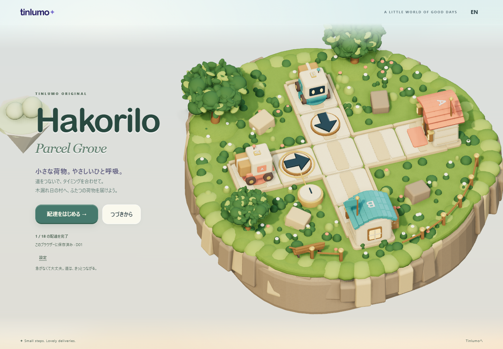
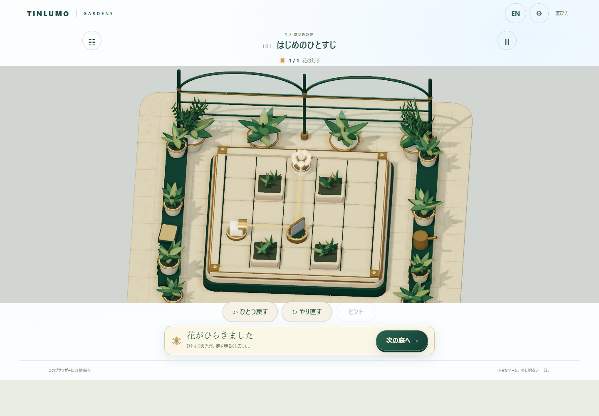
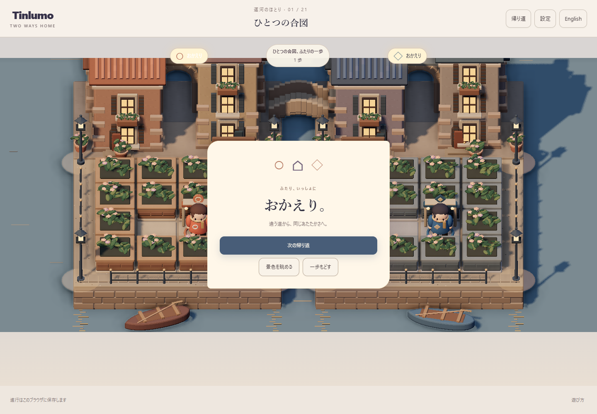
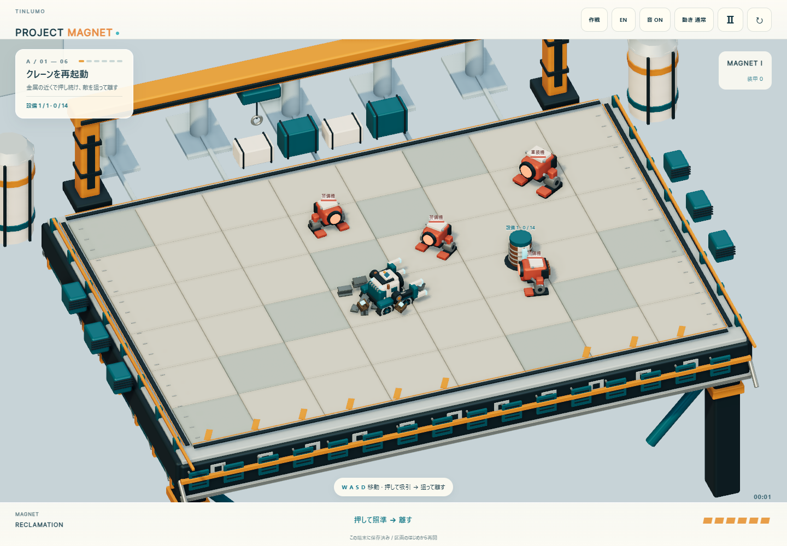
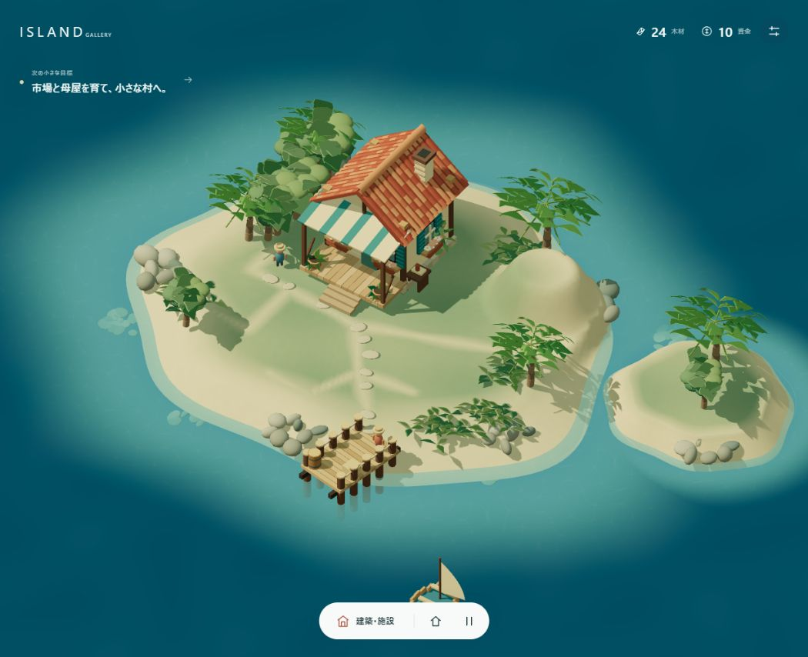
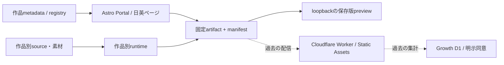

# Tinlumo / Web Game Studio

日英対応のオリジナルWebゲーム8作品と、作品を探して遊べる静的Portalの開発・保存リポジトリです。短い時間で遊べるゲームを、企画、デザイン、実装、検証、配信まで一貫して制作することを目的としていました。

**Tinlumo事業と一般配信は終了しています。** このGitHubリポジトリは2026年11月9日にPublic化した開発記録・保存版です。ゲームの一般配信や事業の再開、再deployを行ったことを意味しません。歴史的な終了記録と外部状態の確認限界は[Project Status](docs/engineering/PROJECT_STATUS.md)を参照してください。利用者数・売上・人気等の実績は主張しません。

## 2026年9月27日の固定5作品版を見る

初めて読む場合は、再ビルドせず**2026年9月27日の5作品版**を閲覧してください。公開時の固定commit・manifestに対し102ファイルのsize / SHA256 / Git blobを検証して復元します。Node.jsとGitだけで実行できます。

```powershell
# このrepositoryのcheckoutで実行。出力先は新規パスを選ぶ。
node scripts/release-preview/restore.mjs --source-repo . --dest .tmp/preview-20260927
node .tmp/preview-20260927/serve.mjs --root .tmp/preview-20260927 --port 4387
```

日本語は [127.0.0.1:4387/ja/](http://127.0.0.1:4387/ja/)、Englishは [127.0.0.1:4387/en/](http://127.0.0.1:4387/en/)。停止は起動した端末で`Ctrl+C`、再起動は2行目を同じportで実行します。port変更時はbrowser saveのoriginも変わります。使用中のportでは既存processを停止せず、空きportを選びます。

復元先が存在すると上書きせず停止します。shallow cloneでは必要objectが不足する場合があります。[Local Preview](docs/engineering/LOCAL_PREVIEW.md)に取得条件、検証、Windows手順、安全処理、最終8作品版の扱いを記載しています。通常の`npm run dev`は初期Portal / fixtureの開発画面です。完成版とは別の経路です。

## 8作品と保存版の関係

| 作品 | 主な遊び | 9月27日版 |
| --- | --- | --- |
| Hakorilo | 矢印とタイミングを組み合わせる配達パズル | 含む |
| ひかりの仕掛け庭 / Lightwork Garden | 鏡を回して花へ光を届けるパズル | 含む |
| ふたりの帰り道 / Two Ways Home | 同じ入力でふたりを家へ導くパズル | 含む |
| PROJECT MAGNET | 磁力を使って進むアクション | 含む |
| 島をつなぐ日 / An Island Connected | 生産・出荷・建設で島をつなぐゲーム | 含む |
| RIMBLOOM | 花と盤面を使った庭園ゲーム | 後続release |
| COILHOP | バネのcharge / releaseで跳ぶゲーム | 後続release |
| 火種と釉 / EMBER & GLAZE | 火と通気を調整する陶芸ゲーム | 後続release |

最終公開系統は8作品です。9月27日版はその前段の5作品であり、8作品を5作品へ巻き戻したものではありません。[Games & Releases](docs/engineering/RELEASES.md)に固定commit、配布物、編集原本、archiveの対応をまとめています。

## 実ゲームの画面

下の画像は2026-09-27の固定配布物を今回ローカル復元し、通常操作した画面の**CURRENT_CAPTURE**です。販促conceptや最終8作品のremaster画像ではありません。[撮影条件](docs/engineering/SCREENSHOTS.md)。

| Hakorilo | Lightwork Garden |
| --- | --- |
|  |  |

| Two Ways Home | PROJECT MAGNET |
| --- | --- |
|  |  |



## 技術構成

Astro、TypeScript、JavaScript、HTML / CSSを中心に、静的HTMLと作品ごとのruntimeを配信していました。最初の5作品にはThree.jsを使った描画、後続作品にはCanvas / Web Audio実装があります。最終remasterの一部にはAI生成bitmapも含みます。依存versionは[package.json](package.json)とlockfileが正本です。



図のCloudflare / D1は過去の構成です。ローカル閲覧にaccount、広告、Analytics、D1は不要です。[Architecture](docs/engineering/ARCHITECTURE.md)は通常build、5作品builder、後続統合、最終保存物を分けて説明しています。

## 開発・検証する

Node.js **22.12以上**とnpm、Gitを使用します。今回の実測環境はWindows / Node v24.14.0 / npm 11.9.0です。意図した削除や別企画が残る既存rootでは、cleanな隔離checkoutを使用してください。

```powershell
npm ci
npm test
npm run build
npm run preview -- --port 4322
# 別端末で実行
npm run test:routes
```

上記build / routesは初期Portalと接続fixtureの検証です。8作品のreleaseを再生成するcommandではありません。`npm run check`の全体検査は今回の保存mainで完走しましたが、既存エラーが残っています。[Development & Testing](docs/engineering/DEVELOPMENT.md)と[Known Issues](docs/engineering/KNOWN_ISSUES.md)に実行条件・結果・限界を記録しています。

## 制作プロセスとHuman / AI

Humanが目的・制約・方向選択・受入・公開判断を持ち、AIが調査、実装、素材制作、テスト、文書作成を支援しました。技術PASSをHumanの全編試遊や実機確認の代用にはしていません。手書き実装率や本人による全作品完走等は推定していません。[Development Process & AI Collaboration](docs/engineering/PROCESS.md)。

## 文書と資産の入口

| 知りたいこと | 入口 |
| --- | --- |
| 現在状態・保全・外部確認 | [Project Status](docs/engineering/PROJECT_STATUS.md) |
| 読み順 | [Engineering Index](docs/engineering/README.md) |
| 8作品・release・原本・archive | [Games & Releases](docs/engineering/RELEASES.md) |
| システムと配信構造 | [Architecture](docs/engineering/ARCHITECTURE.md) |
| 導入・build・test・troubleshooting | [Development & Testing](docs/engineering/DEVELOPMENT.md) |
| 隔離閲覧・停止・再起動 | [Local Preview](docs/engineering/LOCAL_PREVIEW.md) |
| 素材・license・権利の限界 | [Assets, Credits & Rights](docs/engineering/ASSETS_RIGHTS.md) |


このGitHub公開は、新しいOSSライセンスや素材の再利用許諾を付与するものではありません。第三者libraryのnoticeは各配布物に保持します。全素材の法務確定や全履歴mediaの個人情報皆無は保証していません。[権利](docs/engineering/ASSETS_RIGHTS.md)と[SECURITY](SECURITY.md)を参照してください。

2026-11-09のR2本人判断：画像・音楽に無断利用した第三者素材はありません（`OWNER_CONFIRMED_NO_UNAUTHORIZED_THIRD_PARTY_ASSETS`）。この確認により、R1で残っていた対象画像・音源の権利HOLDをR2で解除しました。第三者libraryのライセンスとNOTICEは引き続き遵守し、このリポジトリ全体へ新しいOSS licenseを付与するものではありません。過去のGit author・committer emailの公開も本人承認済みです。適用範囲と記録は[Assets, Credits & Rights](docs/engineering/ASSETS_RIGHTS.md#r2-owner-decision)を参照してください.

過去の作業指示・レビュー記録にある命令形や外部操作許可は、現在の作業権限ではありません。


リポジトリのPublic化は、ゲーム配信の再開や外部サービスの稼働確認を意味しません。過去の配信環境は別途確認が必要です。

公開準備の履歴・原証拠・保留条件は[公開準備候補R1の範囲](docs/PUBLICATION_PREPARATION_R1.md)を参照してください。

## 公開準備 R2

作者・committerメールの公開承認と履歴整理の経緯は[公開準備R2](docs/PUBLICATION_PREPARATION_R2.md)に記録しています。R1の本人確認待ちは解消済みです。Privateでの移行検証を経て、2026年11月9日に既存のGitHubリポジトリをPublic化しました。
