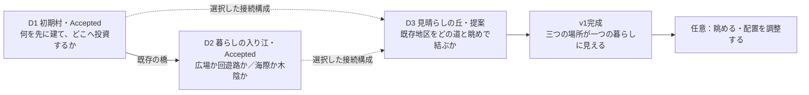

# GAME005 Full Game Scope Research R1 — Human Review

2026-09-23。**研究・設計のみ。Full Game、代表Slice、stress fixtureは未実装。**

**GAME005_FULL_GAME_SCOPE_RESEARCH_R1_READY / HUMAN_FULL_GAME_SCOPE_DECISION_PENDING**

## 1. 推奨する最小十分なv1

**推奨はC1「三つの場所が、一つの暮らしになる島」：全3地区、住民3人、木材・資金の2資源。** Acceptedの初期村と暮らしの入り江に、全島の関係を変える「見晴らしの丘」を1地区だけ加え、一度の完成を明示する。地区数には既存2地区を含む。3地区を新規追加する提案ではない。

想定する本編は初見で**15〜30分程度の仮説**、眺める・比較する・再配置する時間まで含めれば30〜60分程度もあり得る。後者を必要コンテンツ時間として約束しない。慣れた通常入力では10〜15分で終わる可能性も受け入れる。**短く終わったことを理由に価格・作業時間・納品回数を増やさない。** 販売／配信上の所要時間表示は初見計測後に決める。

ただし、**C1を今すぐFull Productionへ渡すことは推奨しない**。次Gateは、入り江の配置選択を受けて「どの既存地区を、どの道と眺めで結ぶか」を試す代表中盤Slice。道の入口や背景を変えただけなら不成立である。高台の歩行・景観・既存地区との接続と、完成後の十分さをHumanが確かめてから、総scopeを確定する。

| 今回提案する判断 | 推奨 |
|---|---|
| v1の大きさ | 全3地区を第一候補。4地区は比較用の保留案、5地区／数時間本編は不採用 |
| 住民・資源 | 3人・2資源を維持。増員・第3資源を完成条件にしない |
| 交易・offline | Acceptedの木材出荷を維持。相場・複雑物流・offline収益なし |
| 完成 | 最後の接続と居場所ができた時点で本編完了。住民を何秒眺めたかは条件にしない |
| 完成後 | 同じ島を眺める／承認された範囲で配置調整。未実装地区の予告で引っ張らない |
| 次に作るべきもの | **Humanが本研究を採用した後**、第三地区の代表Slice＋別扱いの技術stress fixtureを検討。今回は作らない |

## 2. Authority・事実・仮説を分ける

Accepted Authorityは [MVP Baseline](GAME005_HIGH_QUALITY_MVP_BASELINE_R1.md)、[Expansion Progression Baseline](GAME005_EXPANSION_PROGRESS_BASELINE_R1.md)、Progression A「住み継ぐ島」、checkpoint `39d2b13d09de5b85eed169fd79a6c3cb78270aef`。原source、原build、保存、採用manifest、旧Reviewは変更しない。

KEEP：一つの島／B Gallery Gold／自動住民作業／個別割当なし／島主体／木材・資金中心／建築・配置・投資順をHumanが決める／景観と住民利用が報酬／短いテンポ／Accepted Craft。全案で維持し、管理要素を増やして長さを作らない。

| 根拠区分 | 本資料での意味 |
|---|---|
| FACT | 公式・開発元が説明する仕様。公式の所要時間表現も独立実測ではない |
| PLAYER REPORT | 実読した個人の投稿。版・機種・嗜好の偏りがあり、一般的な頻度や原因の証明ではない |
| LOCAL OBSERVED | ローカルsource、保存済みQA記録、採用hashを確認。今回の競合実プレイ・新規Human試遊は0 |
| HYPOTHESIS | 以下の時間、地区、費用例、制作量、性能判定案。すべて設計仮説で、実装許可・実測ではない |
| UNKNOWN / NOT TESTED | 面白さの十分性、実プレイ時間、長期継続、物理iPhone／Safari等。資料だけでPASSへ変えない |

**時間設計の起点**：[Accepted通常入力A](../../game005-island/expansion-r1/review/route-A-play.json)は312.49秒、[B](../../game005-island/expansion-r1/review/route-B-play.json)は342.56秒。MVPから入り江まで約5〜6分であり、Human初見の平均ではない。以前の[Progression研究](GAME005_PROGRESSION_RESEARCH_AND_EXPANSION_R1.md)の2h／10hは長期仮説だった。**今回はそれを必要尺・制作約束として継承しない。** A方向のHuman受入と、当時の時間・人数の仮説は別である。

## 3. 追加調査でScope判断に効いたこと

既存10作品の[出典台帳](GAME005_PROGRESSION_RESEARCH_R1_SOURCES.md)を再利用し、新規作品は **ISLANDERS: New Shores 1作だけ**追加。Outlanders／Outlanders 2／The Final Earth 2の資料を再確認し、短い完了の公式例、長いrunへの反応、完成後の遊び、交易の理解負荷を補った。資料のURL・日付・版は§15に集約する。人気・レビュー件数・売上からGame005の需要や継続率を推論していない。

| 論点 | 一次情報 FACT | プレイヤー評価 PLAYER REPORT | Game005への推論 |
|---|---|---|---|
| 小さくても完成を作れるか | Dorfromantikは75タイル／公式説明で約10分のQuick Modeを用意 [F1]。New Shoresは後の更新で3島の短いmodeを追加 [F3] | New Shores発売初期の20島runに疲労や区切りの不明瞭さを挙げる声 [P1] | 同じ核を保ち、範囲・完了条件を絞ることには実例がある。本作の適正時間を証明した資料ではない |
| 中盤の反復はいつ始まるか | New Shoresは距離・視線等の空間条件で配置を変える [F2] | 原作ISLANDERSの既存レビューは内容を見終えた感覚、Dorfromantikは習熟後の反復への好みの差 [旧S3/S5] | 分数や地区数の普遍的閾値は不明。「新しい関係を読まず、前回の手順で処理できる地点」を本作の反復開始として観測する |
| 完成後も遊べることは必須か | The Final Earth 2はstoryとfree playを分ける [F6] | Tiny Gladeでは達成表示を求めつつ継続したい人と、実績が自由を狭めると考える人が併存 [P2]。Final Earth 2には完了後の目標不足を感じる評価 [P6] | 本編の完了を伝え、継続は任意にする。全員を無期限に遊ばせることをv1完成の要件にしない |
| 資源・住民を増やす価値 | Outlanders系は資源・幸福・生産等を扱う別の管理設計 [F4/F5] | パン加工の土地・労働に見返りを感じにくい、専用保管が複雑という旧版評価 [P3/P4] | 数が多いことより、追加概念に見合う判断と景観の差が必要。本作で3人・2資源が不足する証拠はまだない |
| 交易の深さ | Final Earth 2の都市間輸送は複数都市に対応する機構 [F7] | Outlanders 2の交易投稿では必要な輸出品・稼働表示に迷い、外部質問へ至った [P5] | 1島・2資源で価格表・交易所別在庫・物流画面を足す理由は弱い。現行出荷の操作負担を測る方が先 |
| 完了直前の作業化 | Terra Nilは段階的な景観回復と鑑賞を説明 [旧S9] | 更新直後に動物の細条件が完了の達成感を損なうという声もあった [旧S9] | 島が完成して見えるのに隠れた訪問回数・納品・人口条件が残る構造を避ける |

反証も保持する。長い最適化や繰り返しを楽しむ層はいるし、sandboxは一度完成してからも遊べる。ただしそれはGame005の強制本編を長くする根拠ではない。New Shoresの発売初期の不満は、その後の短いmode導入を併記し、現在も未対応の欠点とは扱わない。

## 4. 三つのFull Game Scope案

**C1/C2/C3は同じAccepted A方向内のScope比較**であり、島を捨てる案への方針変更ではない。地区数は初期村と入り江を含む。時間は中断を除く初回本編の仮説で、広告できる実測値ではない。鑑賞・再配置・再プレイを本編尺へ算入しない。

| 項目 | **C1 Compact：一つの島を結ぶ（推奨）** | **C2 Standard：働く浜を持つ町（保留）** | **C3 Extended：島の周回を育てる（不採用）** |
|---|---|---|---|
| 本編時間の仮説 | **15〜30分**。慣れたルート10〜15分も許容。任意鑑賞等を含む30〜60分は別枠 | **45〜90分**。丁寧に比較して1〜2hの可能性。現行テンポでその密度を作れるか未証明 | **2〜3h以上を狙う比較案**。異なる判断の供給根拠が不足し、必要尺として採用しない。10h前提なし |
| 地区数／順序 | **3**：初期村→入り江→見晴らしの丘 | **4**：初期村→入り江→浜の仕事庭→見晴らしの丘 | **5**：初期村→入り江→浜の仕事庭→背道の森→見晴らしの丘 |
| 住民 | **3**。既存2→3の導入は保持 | 3をcontrolに、4人の意味を比較。4を必須解放にしない | 4〜6を比較する必要が生じる。人数増と島の空洞化の両方がリスク |
| 資源 | **2**：木材／資金 | 2。第3資源なしでも仕事庭の判断が成立する必要あり | 2を原則。第三資源を追加して長さを正当化しない |
| 建物カテゴリ | 生活／生産／交易／公共景観／接続の5役割。新規は公共1・接続1 | 同5役割に仕事庭の生産・運搬配置を深める | 同5役割で長距離の接続優先を追加。別の管理カテゴリは増やさない |
| 新規投資対象 | **2**：丘を結ぶ道、見晴らしの縁。追加資源納品の最終工事は不要 | おおむね4〜5。仕事庭で2〜3、丘で2 | おおむね6〜8。仕事庭・森・丘のための独立判断が必要 |
| 主な節目 | 生産基盤→暮らしの居場所→既存地区が一つの構成に見える→完了 | 上記＋働く動線と憩いの場所の両立 | 上記＋長い島でどこを短く結ぶか。効率だけを解くゲームへ寄りやすい |
| session | 3〜5分で判断と結果、10〜15分で一つのまとまり。2〜3回で終了もよい | 3〜5分の局所整備／10〜15分の地区内節目を4〜6回。成立未確認 | 同じ短いsessionを反復するだけになる危険。再開時の地理把握が重くなる |
| 最終状態 | 初期村・入り江・丘がつながり、以前の配置が最後の眺めに残る | 生産と休息が共存する小さな港町 | 島全域を巡る町。ただしカメラ移動・道探索・待機が増える |
| 制作量の仮説 | 新地区Art kit1、道構成2、眺望構成2、全島完成演出1。既存2地区は作り直さない | 新地区kit2、丘に加え仕事場配置・運搬の検証 | 新地区kit3、追加住民・広域動線・景観の整合が必要 |
| 相対制作負荷 | **2〜3.5U** | **4〜6U** | **7〜10U以上** |
| 技術負荷 | 中：高低差・route・camera・保存の契約を1地区で検証 | 中〜高：運搬先／中継／追加人口の必要性まで波及 | 高：描画・保存状態・navigation・長sessionを同時に拡張 |
| 反復リスク | 中：最後が入り江の置き換えに見えると成立しない | 高：市場・作業場・桟橋を再び建てるだけになり得る | とても高い：区画、費用、待機だけ増える可能性 |
| 005らしさを壊すリスク | 最小。ただし地形操作を細かいeditorにしない | 交易／運搬を管理する時間が島を見る時間を奪う | 人員・経路・在庫を管理する別ゲームへ寄る |
| 判定 | **代表Sliceを条件に第一候補** | 第三地区受入後でも、足りない価値を特定できる場合だけ再検討 | 現時点で根拠不足。制作計画へ入れない |

Uは「Accepted入り江と同程度の設計・Art・挙動・UI統合・QAを一体で仕上げる作業量」を1とした紙上比較。工数実績・人日・納期・費用ではない。高低差の検証失敗でC1も上振れする。日程は代表Sliceの実作業量から見直す。

**C1を選ぶ理由**は、手持ちの5〜6分から無理なく増やせるかを最も早く検証でき、第三地区に全体の完成という役割を持たせられるため。長めの案を推した独立市場調査の視点もあったが、現行content量と技術制約を統合すると、1〜2hを先に約束する根拠はない。**15分で満足できる完成品を、60分かかる未完の島より優先する。** 逆に15分で薄いと感じた場合は、資源や待機を増やさず、第三地区の判断と完了の見せ方を再設計する。

## 5. 地区構成と、各地区に必要な新しい問い

以下は**接続関係の設計図**。実地形の座標・面積・高低差が確定した配置図ではない。Accepted地形をこの図に合わせて変更する許可ではない。

| 地区 | 何を選ぶか | 景観で変わるもの | 住民の使い方 | 前地区との差／次への期待 |
|---|---|---|---|---|
| **D1 初期村 — Accepted** | 生産・母屋・市場の投資順、市場の配置。既存選択を変更しない | 壊れた桟橋、家、仕事場、市場、橋が一つの村になる | 自動採集・運搬・建設・出荷 | 「生活基盤を作る」。橋先を使いたい期待がD2へつながる |
| **D2 暮らしの入り江 — Accepted** | 広場先行／回遊路先行、海際／木陰 | 小道、広場、縁台、植栽と通行・滞在のまとまり | 余剰時間に歩く・立ち寄る・座る。仕事へ自動復帰 | 「通過する土地を居場所にする」。最後は、その居場所を含む島全体を見たい期待へ |
| **D3 見晴らしの丘 — C1の新地区** | ①村側の往来をまとめる接続か、入り江側の回遊につなぐ接続か。②既存の広場への見通しを開く構成か、木立を残して低い縁台から切り取る構成か | 道が二つの既存地区との関係を作り、前に選んだ広場・市場が最終景観に現れる。木立の輪郭・段差・見通しが変わる | 片道の新ベンチ訪問ではなく、旧地区→丘→別の既存地区の連続した散歩。仕事発生時は実routeから復帰 | **地区単体の置き場所から、過去の選択を含む全島の構成へ**。次の未知地区ではなく、島の完成が期待になる |
| **浜の仕事庭 — C2/C3のみ** | 既存出荷へ寄せる仕事場配置か、村側に作業をまとめ海際を人の場所として残すか | 荷物の動きと休む場所の分離、空いた浜、道の使い分け | 同じ木材の自動運搬とidle通行が異なる動線を使う | 「どこに座るか」から、仕事と生活の空間の両立へ。新桟橋の複製だけなら削除。仕上がった働く浜を丘から見る期待 |
| **背道の森 — C3のみ** | どの既存2拠点を近く結ぶかを選び、もう一方は既存routeを使う | 島の裏側の道と、残る森のまとまり | 実際の目的地への経路選択と散歩の通過地点が変わる | 広域の接続優先へ。ただし効率パズル・遠距離待機のリスクが高い。最後の丘で全島を読む期待 |

D3の2接続案は、**別入口の短い枝道が同じ休憩所へ着くだけでは不可**。両方とも既存地区同士を結ぶが、接続先・通過する旧地点が異なる有限の構成とする。各案の実座標、通れる地面、海岸との接続、既存橋との関係はSliceで確認し、図上の線だけで成立扱いにしない。島を増やさず、承認済み地区の原sourceをそのまま比較対象に残す。

見通しの選択は新しい地区内の植栽・縁台の構成として扱い、Acceptedの木立や建物を強制撤去しない。数値の幸福度・魅力度・眺望点を導入しない。元の広場が見えない場合を罰にせず、「広く町を見る」と「木立越しに一部を見る」の双方を完成形にする。

**地区候補の採否**：独立した港はMVPの桟橋・市場との役割重複が大きくC1から外す。木陰／庭はAccepted入り江がすでに担うため、単独地区へ水増ししない。高台は見た目だけなら採らず、過去の配置との関係が変わる場合だけ採る。背道・仕事庭はpost-v1候補であり、C1を不完全に見せる予告には使わない。

## 6. 30分 / 1h / 2h / それ以上の成長像

時刻どおりにunlockさせない。下表は各案を選んだ場合の状態仮説で、未実装・未実測。「その時間まで遊ばせ続ける」要件ではない。

| 累積時間 | C1 Compact | C2 Standard | C3 Extended |
|---|---|---|---|
| **30分** | 主線完了、または丘の最終構成を選ぶ。以前の市場・入り江配置が全体像に残る | 仕事庭の用途と接続を比較。旧村の生産を繰り返すだけならこの案を縮小 | 仕事庭に到達。序盤が同じまま長いなら早くも不成立 |
| **1h** | 完了後の任意鑑賞・再配置、またはすでに満足して終了。新しい必須地区は出さない | 丘へ到達し島の完成に近づく、または完了 | 森の接続を選ぶ。広域管理の負担が出る可能性 |
| **2h** | 新しい本編はない。別構成を見たい人だけ戻る。2h分のcontentがあるとは言わない | 本編完了。任意調整のみ | 最終の丘に到達する仮説。ただし異なる判断の量は未証明 |
| **それ以上** | 保存した島を眺める／少し配置を変える。何もせず離れても損失なし | 同左。daily等で拘束しない | 数時間化の根拠不足。追加管理・納品で延長しない。10h設計を採用しない |

C1の紙上時間内訳：Acceptedまでの既知ルート約5〜6分＋第三地区の通常操作・比較・観察約4〜8分＋全体を見て終える約1〜2分＝慣れた経路で約10〜16分。初見の理解や迷いで15〜30分になる可能性がある、という程度の仮説である。**その初見時間を増やすために説明を長くしない。** 30〜60分は任意の眺めや別配置まで含む人の幅であり、現在の根拠では保証できない。

## 7. 住民・資源・建物カテゴリ

| 比較 | 意味があり得る条件 | 負担と判断 |
|---|---|---|
| **3人を最後まで維持** | 一度に全地区へ均等配置せず、同じ住民が過去の場所と新しい場所を行き来することで一つの生活圏に見える | **C1推奨**。各地区に常時1人を置く義務や空いた地区への警告を作らない |
| **4人** | 3人では旧村が毎回空になり、経路調整だけでは生活感が戻らないことを通常試遊で確認できた場合 | 比較実験候補。食料・幸福・職業・住居待ちなし。人数増を節目そのものにしない。初期C1には入れない |
| **5〜6人** | 広い地区構成が本当に必要で、複数の行動を見せる価値が増員コストを上回る場合 | 現時点で不採用。現在の描画は3体固定、保存は2/3人を検証、idle開始条件にも上限がある。単なる定数変更ではない |
| **2資源** | 限られた投資をどの接続・場所へ使うかで結果が変わる | **推奨**。景観選択に不足は未確認。既存の木材・資金を使う |
| **第3資源：石材等** | 例えば木造迂回と石積み直線路のどちらへ希少資材を使うか、既存2資源では表せない排他的判断がある場合 | 今回は必要性なし。経路2案と土地の使い方だけで同じ判断を表現できる。採集・保管・費用欄を増やす価値を示せないため不採用 |

現在の実装では、5〜6人へ増やしたときidle clockの上限6秒に対しID4/5の開始閾値が6.8/8秒となる。これは**未採用の増員仮説に対する制約**で、現行3人の不具合認定ではない。[core](../../game005-island/expansion-r1/src/core.ts)、[3体描画](../../game005-island/expansion-r1/src/scene.ts)。今回は修正しない。

建物数を先に決めず役割で固定する。C1は既存8投資種に新規2対象を足す**最大10投資種程度の設計枠**。自由配置の同型小屋を量産する枠ではない。

| 役割 | C1の対象 | 何を明確に変えるか |
|---|---|---|
| 生活 | 既存母屋拡張 | 2→3人のAccepted導入。追加人口施設なし |
| 生産 | 既存作業場 | 自動採集の基盤。石材工房等を足さない |
| 交易 | 既存桟橋・市場 | 木材出荷と市場配置。第二市場・相場画面なし |
| 景観／公共 | 入り江の広場＋**見晴らしの縁** | 座る場所と、過去の島を見る構図。新地区の植栽・小物は一体のArt kitで、購入リスト化しない |
| 接続／移動 | 既存橋・入り江の小道／回遊路＋**丘を結ぶ道** | 地区間の実route・通過地点。タイルを1枚ずつ敷く反復は不要 |

全投資の採用条件は景観・判断・住民行動のいずれかを明確に変えること。D3についてはさらに、接続と利用の差を必須とする。既存モデルの色替えや新しい名前だけの投資は0。

## 8. 経済・交易・Goal・offlineを増やさず深める

**交易**：木材4→資金6、市場後8というAccepted出荷を基準とする。価格変動、島別／建物別在庫、船の配車、交易契約、期限、別通貨はC1に入れない。新しい島がない本作に都市間物流を移す必要性は確認できなかった [F7/P5]。

第三地区の初期費用案は、道12木材＋6資金、縁8木材＋6資金、計20木材＋12資金。**設計試算であり現行BALANCEを変更しない。** 市場後の出荷8資金なら、開始資金0でも新たな必要出荷は最大2回。開始資源は通常継続の実値を使い、補助金やQA専用盛り付けをしない。採集・移動・工事の時間はAcceptedを参照し、尺のために増やさない。完了後の余剰資源を消費させるsinkを無理に作らない。

まとめ出荷は現時点で不採用。もし既存出荷の回数が実際に負担になった場合だけ、必要支出・1回収益から回数削減を実算する。「便利そう」だけで交易拡張として扱わない。

**Goal**は現在の地区に1つ、既存Galleryと島の変化から進行を理解できる長さにする。全地区のチェックリストを常設しない。

| 節目 | 短いGoal案 | 自然に伝えるもの | 完了条件から除くもの |
|---|---|---|---|
| 初期村 | Acceptedの目標を保持 | 出荷・自動作業・投資 | 新しい説明やNPC会話の追加 |
| 入り江 | 「橋の向こうに、人が集まる場所を。」 | 居場所と回遊路の使われ方 | 住民訪問回数、滞在時間の集計 |
| 丘 | 「育てた二つの場所を、ひとつの道へ。」 | 前の配置を見て接続・眺めを選ぶ | 特定の正解配置、人口増、追加の納品表 |
| 完成 | 「この島に、暮らしがつながった。」 | 本編を終えたことと継続可能性 | 未実装地区のComing soon、daily、100%収集率 |

**offline比較**：

| 案 | 利点 | このv1での問題／判断 |
|---|---|---|
| **進行停止・同じ状態から再開** | 建設・生活圏が変わる瞬間を本人が見られる。時間差計算なし | **採用推奨**。損失・維持費なし、復帰後すぐ次の判断へ。正確な保存・再開を優先 |
| 依頼済み1工事だけ閉じた間に完了 | 待つだけの工事が残る場合に中断しやすい | 待機が短い本作では価値が未証明。完成を見逃すので不採用 |
| 収益を時間比例で加算 | 再開時の資金余裕 | 未実行の投資判断を飛ばす／放置が最適になる／時刻改変・cap等の説明が増える。「再訪促進」だけでは採らない |

非表示tabのtimer／animationは制限され得る [T2]。自動住民作業と、閉じている間の進行は別物である。Webと将来Appで同じ「離れても失わず、続きから判断できる」を優先する。App Store・native lifecycle対応は今回実装しない。

## 9. Session designと完成の見せ方

| 長さ | 体験の単位 | 中断・再開 |
|---|---|---|
| **3〜5分** | 候補を見る→場所／接続を1つ選ぶ→工事か住民利用の変化を見る | 地区完成を中断条件にしない。途中保存を使い、復帰時は既存の状態・CTAで続きを示す |
| **10〜15分** | 一つの発展の意味が分かるまとまり。Acceptedの続きから第三地区と完了まで届いてもよい | 長い強制説明・一括やり直しなし。資源不足なら既存の出荷・自動採集へ戻るだけ |
| **それ以上の連続** | 区切りを閉じず次の判断へ進める。完成後も同じ画面で島を眺める | 毎回「次章開始」の管理画面を挟まない。無期限の新contentを約束しない |

v1の完成条件は、Accepted初期村・入り江の節目に加え、D3の道と縁が完成し、選択したrouteが既存地区を実際に結ぶこと。条件が成立した瞬間に保存でき、**住民の到着、船の時刻、追加資源、一定時間の鑑賞を待たせない**。

完成時は既存Goalの短い完了表示と任意の全島俯瞰を提案する。長いcutscene、画面を奪う結果画面、強制的な物語Endingは不要。入力を止めず、その後の数秒〜十数秒で住民が旧村・入り江・丘を自然に使い、最初の村が残ることが見える。住民を瞬間移動させたり、この瞬間だけ仕事を停止して美化しない。

全島完成は一度の到達として保存する。完了後はAcceptedで可能な市場・広場の移設と、新地区の接続2択×眺望2択による有限な4構成の変更を候補にする。この2択は独立し、組合せ済みの2セットに限定しない。道路自由editorは追加しない。新構成への変更は有効な配置から別の有効な配置へ行い、完成を毎回失わせない。変更中の資源・工事・座席・routeの整合は次Sliceの技術確認対象である。

**十分な完成かを判断する問い**：「新しい地区はもうない」と正直に伝えても、Humanが作品の終わりとして納得できるか。次を要求された場合は、それが満足した後の追加希望なのか、いまの島の未回収の約束なのかを分ける。前者を埋めるためにv1を無制限に伸ばさない。

## 10. v1 / post-v1の境界と制作量

| **C1 v1に必要** | **post-v1候補・今回の制作計画には入れない** |
|---|---|
| Accepted2地区＋第三地区1つ、接続2構成・眺望2構成 | 仕事庭、背道、港等の追加地区 |
| 自動仕事／idle利用、既存3人・2資源 | 4〜6人、第三資源、新しい島、大きな交易 |
| Gold Galleryへの2投資対象の統合、短いJA/EN Goal | 全体管理画面、NPC会話・daily量産、challenge mode |
| 明確な完了、継続鑑賞、有限な再配置 | cosmetic variationの量産、季節システム、住民衣装 |
| 完成・途中工事・route／構成を確実に保存し再開 | cloud save、account、オンライン共有 |
| 代表視点でのCraft維持、保存失敗の正直な表示、QA | offline収益、App固有機能、App Store対応 |

「v1に必要な保存の安全性」をcloud saveまで先送りする意図はない。長いデータを失わないため、現行local保存の破損保全・conflict・失敗表示・schema検証を新状態でも維持する。保存を絶対安全とは言わず、WebKitのeviction方針も考慮する [T3]。local backupが必要かは保存検証後の限定判断で、今回追加しない。

C1の追加制作を分解すると、①地区全体の構図と接続2案、②地面・道・縁台・植栽・小物を含むArt kit1式、③高低差と実route、④Gallery2投資とJA/EN短文、⑤完了・再配置・保存契約、⑥通常入力・Craft・性能の検証、となる。モジュール数の多さを価値とせず、**この一式をAccepted密度まで仕上げられるか**で判断する。

新しい2接続×2眺望×既存広場2配置で少なくとも8構成、既存市場2配置まで含めると16構成の整合を考える必要がある。これは16地区／16本の物語を作る意味ではない。技術的な配置・route・保存の組合せ確認と、§12の代表6構成の通常試遊を分離する。C2/C3はさらに組合せが増えるため、地区数の比率だけでは工数を見積もれない。

リリースには最終の製品Human Gate、法務・権利・公開・広告等の既存Gateが別にある。本scope受入だけで公開許可は得られない。旧作／Portal／registryを今回変更しない。

## 11. 性能・技術Scope：地区を一つ足す前に何が必要か

### 現在確認できる範囲

[既存の性能記録](../../game005-island/expansion-r1/review/performance.json)はWindows Edge／RTX 4060 Tiで、各cell約1.2秒warmup＋約7秒測定の技術fixtureである。通常入力動画とは別証拠。desktopの同じhome cameraではMVP→Expansionでdraw callsが317→445（約40%増）、JS処理が90.91→102.81ms/s、heapが19.52→22.30MBとなり、描画間隔p95は双方16.8ms。lowのmobile viewport模擬ではdraw calls166→230、p95は双方33.5msだった。これは第三地区を追加できる余裕や、実機での安定性の証明ではない。

**Physical iPhone／SafariはNOT TESTED。** 現時点の必須Gateにせず、Web／将来Appの性能保証へ読み替えない。短いdesktop測定では熱・電池・長時間memory・iOS保存維持は確認できない。

| 増加／変更対象 | ローカルsourceから分かる制約 | C1での境界・次に確認すること |
|---|---|---|
| 建物・植生・小物 | 描画groupとmaterialの数、shadow、透明物・海面等も効く。見えない配置候補のobjectが保持される場合もある | 地区1kitに限定。同じ画角・同じ品質で比較し、Art Densityを落として数値だけ合わせない |
| 住民 | sceneは3モデル。保存は家の前後で2／3人を検証。現在の仕事slotも増員前提ではない | 3人維持。4〜6人を「数字変更だけ」で追加できるとは見積もらない |
| animation／自動行動 | 現行3人の短い固定graph向け。idle開始条件や仕事slotは一般的な人口simulationではない | 丘追加でも仕事復帰・旧地区の利用・座席の競合を確認。仕事がなくなるまで全員がずっと丘に滞留する設計を避ける |
| 高台・接続 | 現在のroute座標はx/z中心で、歩行高さ・pick plane・植生基部等に平面前提がある | 高台はArtだけ持ち上げず、地形・足元・道・建物基礎・入力面を合わせる。浅い段丘で成立するかもSliceで比較。名前だけ「丘」にした平面の入り江複製は採用しない |
| 経路・島範囲 | 保存validationには座標境界・route点数の上限がある。距離が伸びると仕事復帰時の移動も伸びる | 現行上限を無思慮に緩和しない。第三地区の実座標と移動時間を測ってから必要範囲を定義 |
| save size・保存時間 | full stateをvalidateして同期JSON保存。活動中の定期保存とイベント保存がある | schema・選択・工事・完了を含む最大状態で検証。上限のある状態を保ち、不要な常時行動履歴を追加しない |
| Gallery | 現在8種類と既存tray、表示中の更新処理がある | 新候補2つを同じDesign Systemに収める。mobileで見つけられるか・操作回数・再描画を確認。カテゴリ管理画面は増やさない |
| long-session memory | 既存7秒測定では長時間のobject保持・preview作り直しの影響は分からない | 同じ状態へ戻した後のgeometry／material数、heap推移、frameを30分確認。増加だけで即leakと断定せず、定常化と再現性を見る |

根拠source：[scene](../../game005-island/expansion-r1/src/scene.ts)、[core](../../game005-island/expansion-r1/src/core.ts)、[game](../../game005-island/expansion-r1/src/game.ts)、[storage](../../game005-island/expansion-r1/src/storage.ts)、[cove art](../../game005-island/expansion-r1/src/cove-art.ts)。WebGLの限界はdevice依存であり、draw callsの削減やGPU資源管理は一般原則であって、この作品の端末保証ではない [T1]。background tabのtimer／描画制限 [T2] とWeb保存のeviction [T3] も、offline導入の理由とは分けて扱う。

### 将来提案するstress fixture（今回は未実装）

Full Production前に、**3地区・3人の発展済み島**を代表fixtureとして提案する。Accepted相当の建物・植生・小物・住民animation密度を持ち、第三地区の通常Sliceとは別にseeded stateで負荷を測る。4／5地区と4／6人はC2／C3の再検討が実際に必要になった場合だけ、追加の負荷対照にする。全案のfixtureを先に量産しない。複製geometry等を使う技術fixtureはその旨を明示し、Human Craft／面白さの証拠へ流用しない。

| 検証 | 提案条件／暫定判断線。実測PASSではない |
|---|---|
| 比較条件 | 同じPC・browser・camera・設定でAccepted2地区と比較。home／新地区／全島、Gallery閉／開、通常／low、1440×1000／390×844 viewport模擬 |
| 短時間性能 | 30秒warmup＋120秒測定を3回。p95 frame間隔は通常20ms以下／low37ms以下を暫定目安、p99と50ms超も報告。同一画角draw callsがAccepted Expansion比25%超増なら構成を調査するが、25%を普遍的上限とは扱わない |
| 入力・保存 | CTA反応p95 100ms以下、同期保存p95 10ms以下・50ms以上の停止なしを仮置き。最大saveは100KB以内を初期予算案にし、まず実サイズを測る。denied／quota／破損／conflictでも原データと失敗表示を保つ |
| 長時間 | 30分、建設・出荷・idle・Gallery・配置previewを反復。preview切替100回の前後で同じ状態へ戻し、資源objectの継続増加がないかを確認。heap単独の一瞬の値で判定しない |
| 行動 | idle→仕事受付は次simulation tickで確認し、現場までの移動時間は別記録。足浮き／地面埋まり／座席競合／道の切断／配置先へ到達不能がないこと |
| 保存・旧作 | 全16配置組合せのroute整合、途中工事／完了／再配置のreload。Accepted MVPとExpansionの原source・原build・namespaceを保全する隔離候補で実施 |

数値は暫定工学予算であり、必要なら実測から厳しくする。性能を満たしてもHumanが見て品質低下を感じたら受入不可。物理端末の状態はこのfixture実行後も、実際に試していなければNOT TESTEDのままにする。

## 12. 次Gate：代表中盤Slice「育てた場所を、ひとつの眺めへ」

**HumanがScope方向とこの限定試作を承認した場合の次工程案。今回の実装許可ではない。** 最後の地区の原型を中盤の判断密度テストとして使う。第三地区全コンテンツ・追加地区・App対応を並行量産しない。

### 最小内容

1. Accepted入り江の直後から、第三地区の「丘を結ぶ道」と「見晴らしの縁」だけを実装する隔離候補。
2. **新しい判断**：既存の村と入り江のどこを通過点として結び、どの育てた景色を眺望の中心にするか。海際／木陰の過去選択を見て次の構成を考える必要があること。
3. **新しい行動**：同じ場所へ往復するだけでなく、既存地区A→第三地区→既存地区Bという連続経路と異なる立寄りが通常simulationで起きること。仕事時は自動で復帰する。
4. **新しい景観**：高低差または浅い段丘を含む、前の二地区を見渡せる構図。地面・海岸・道・縁台・木陰をAccepted密度でつなぎ、全島が一つの暮らしとして見えること。
5. 接続と居場所ができれば短い完成表示。次地区予告や追加納品で完了を延期しない。通常操作で再配置できる最小範囲も確認する。

目標は新部分4〜8分程度の仮説。4分で密度があるなら採用できる。足りない場合は経路と判断の関係を修正し、建設時間・移動距離・必要出荷数を増やして時間を埋めない。所要時間だけでSliceをPASSにしない。

### 通常入力の比較とHuman判断

| 経路 | 既存側の条件 | 第三地区の提案選択 | 比較したい差 |
|---|---|---|---|
| A | 海際広場 | 村側を主な入口／海と旧広場を開いて見る | 村の仕事→丘→海際の居場所が連続して見える |
| B | 木陰広場 | 入り江側を主な入口／植栽を残す低い縁 | 入り江の回遊→木陰の滞在→旧村への帰路が見える |
| A-cross | Aと同じ既存島 | B側の接続・眺望構成 | 既存配置の違いだけでA/Bが良く見えていないかを検証 |
| B-cross | Bと同じ既存島 | A側の接続・眺望構成 | どちらの過去選択でも新構成2案が正解として成立するかを検証 |
| Mixed-V | Aと同じ既存島 | 村側の接続＋植栽を残す眺望 | 接続と眺望を独立して選んでも、歩行・景観・滞在が成立するか |
| Mixed-C | Bと同じ既存島 | 入り江側の接続＋開いた眺望 | もう一方の混合構成も有効で、暗黙の正解セットを強いていないか |

実座標・実経路は未設計であり、この表は検証する意味の違いを指定している。全6構成を通常入力で確認する。A/B/crossは通常操作で作成したAccepted相当の進行から始め、Mixedはその後の通常再配置で確認してもよい。通常saveのreload／複製を比較開始点に使う場合は由来を記録し、候補のschema移行は別途検証する。Mixedにも景観・住民利用・Human比較を行い、技術上routeが通るだけで正解扱いしない。state注入・住民の瞬間移動・Review専用美化を通常試遊証拠に使わない。

Before／建設中／完成直後／通常利用／最終景観を同じcameraでも収録し、等速通常試遊動画を残す。idle→work→idle、途中保存、選択保存、完成保存、JA/EN、desktop/mobile viewport、Gallery、既存regressionを影響に応じて確認する。技術fixtureの映像は別ラベルにする。

Humanへは、次を実試遊で確かめてもらう。

- 前の広場・市場の置き方を見て、今回の入口・眺望を選び直したか。選び直す理由を3D上で示せるか。
- 接続前と後で旧地区の使われ方まで変わり、単なる新しい休憩所の追加以上に感じるか。
- 説明文を読まなくても二つの構成の歩行・立寄り・滞在・景観の違いが分かるか。
- 3人でも島の一部が放置されたように見えず、待機や仕事への復帰が面倒になっていないか。
- 完成後に少し眺めたくなり、「新しい地区はこれで終わり」と伝えても一作品として納得できるか。
- Gold UI、Craft、短い操作テンポはAcceptedを維持しているか。

**次へ進める条件**：技術とCraftの確認に加え、Humanが第三地区の判断差と全島の完成感を受け入れること。独立reviewが「入り江の道とベンチを移しただけ」と判断した場合はREADYにせず、原因と修正版を提示する。地区を追加することを自動的な修正策にしない。

第三地区が良くても「これでは未完成」という評価なら、未回収の約束を特定する。働く場所と暮らす場所の関係が欠けている場合だけC2の仕事庭を再研究する。所要時間が短いだけならC2へ拡張しない。Slice通過後も、Humanの明示決定までFull Productionへ移行しない。

## 13. UNKNOWNと判断を変える証拠

| UNKNOWN | 判断を変えるために必要な証拠 |
|---|---|
| 全3地区で完成品として十分か | 上記Sliceを含む初見通常試遊。「追加が欲しい」と「現状が未完成」を分けたHuman理由 |
| 15〜30分の本編仮説 | 複数の初見sessionで操作／考える／迷う／待つ時間を分けた実測。既存の慣れた5〜6分から平均を捏造しない |
| 丘の判断が入り江と違うか | 同じ旧配置から異なる新構成を選ぶcross比較。旧地区まで行動と見え方が変わる通常動画 |
| 3人の生活感が島全域に届くか | 同じ3人の行動分布とHuman観察。全員を新地区へ呼ぶ脚本演出で補わない |
| 高低差／新接続の技術負荷 | 実座標・基礎・歩行高さ・pick・route・保存を含む隔離Slice。Artだけでは未検証 |
| 初見に適した費用とsession | 追加出荷が意味のない手数にならないか、3〜5分後に気持ちよく中断できるかの観察 |
| 再配置の楽しさと保存整合 | 配置変更の通常操作、工事・仕事・座席・完成flagの保存/reload。自由editorを求めるかは別問題 |
| physical mobile／Safari・将来App | **NOT TESTED**。emulationで代替しない。今回の必須Gateには追加しない |
| 長session／保存維持／実機性能 | §11の比較・soakと必要時の実端末確認。Web保存の永久保証はできない |
| 市場での満足・再訪・価格適合 | 独立した初見・市場検証。本調査は売上・継続率・価格の根拠を得ていない |

## 14. 今回の完了範囲とHuman Decision

今回の成果はこの一つのReviewと、[検証・保全記録](../qa/game005-full-game-scope-research-r1/REPORT.md)。新地区source、save schema、Gallery、asset、stress fixtureは未実装。C1を第一候補として比較設計した段階であり、Human Scope AcceptanceはPENDING。

Humanに残す決定は、**全3地区・3人・2資源のC1を次の検証対象にするか、および第三地区の代表Sliceを次Gateとするか**である。時間の約束・Full Production・公開・将来追加をまとめて承認する必要はない。採用の場合も、次の明示依頼があるまで制作しない。

Securityは[S01〜S05の既存Human disposition](../security/GAME005_EXPANSION_R1_HUMAN_DISPOSITION.md)を変更しない。S01〜S03は提示済み3候補だけの過去承認。S04〜S05は **historical UNKNOWN / UNRESOLVED** のまま。**前回checkpoint-only risk acceptanceは使用済みであり、将来のcommit／releaseへ転用不可**。新規候補が出れば従来ルールで停止。allowlist・scanner rule・秘密の削除／rotationは行わない。今回の対象文書scanを、全repo／履歴／distributionの新しいPASSへ読み替えない。

Accepted MVP／Expansionの原source・原build・manifestを照合し、開始時の既存worktree・HEAD・upstream・indexを保全する。物理iPhone／SafariはNOT TESTED。公開Web資料の読取以外の外部操作、stage／commit／push／deploy／public registry／Cloudflare／Ads／App Store／外部設定変更は0。

実利用モデル：主担当 **gpt-6-astra**。競合調査2系統とsource／技術制約の独立read-only reviewも、同モデルを継承したgpt-6-astra。writerは主担当のみ。既存の製品受入と今回の研究完了を分ける。

**GAME005_FULL_GAME_SCOPE_RESEARCH_R1_READY / HUMAN_FULL_GAME_SCOPE_DECISION_PENDING**

## 15. 追加・再確認した出典（閲覧2026-09-23）

### 一次情報

| ID | 出典・対象 | この研究に使った内容／限界 |
|---|---|---|
| F1 | [Dorfromantik公式1.0更新 2022-04-28](https://store.steampowered.com/news/app/1455840/view/3190247426139007010)／[本文を確認したSteam公式配信一覧](https://store.steampowered.com/news/posts/?enddate=1651135483&feed=steam_community_announcements) | Quick Mode75tiles、約10分という開発元説明。独立した平均時間の計測ではない |
| F2 | [ISLANDERS: New Shores公式Steamページ](https://store.steampowered.com/app/2368930/ISLANDERS_New_Shores/) | 距離・視線等の配置関係、空間条件。PC/Mac版。掲載のmode数は後の更新と異なるため現在の総mode数を断定しない |
| F3 | [New Shores公式announcement一覧](https://steamcommunity.com/app/2368930/announcements/)：2025-08-28 Challenge Update、build #2f95a55d | 3島で区切るA Short Journeyと時間制challenge。短い範囲を選べる例として使用し、005への時間制限は推奨しない |
| F4 | [Outlanders公式App Store](https://apps.apple.com/us/app/outlanders/id1463407936) | Apple Arcade版のlevel・leader・資源／幸福・decree等。PC版との差は同一視しない |
| F5 | [Outlanders 2公式App Store](https://apps.apple.com/us/app/outlanders-2/id1614682164) | campaign／biome／challenge／Field Guide。現在の正確なコンテンツ総数はscope判断に使用しない |
| F6 | [The Final Earth 2開発元HTML5配信ページ](https://flori9.itch.io/the-final-earth-2) | story／free play、資源・研究・建設。About an hourの欄は開発元掲載metadataでありプレイヤー平均ではない。native版の全追加機能と混同しない |
| F7 | [The Final Earth 2公式App Store](https://apps.apple.com/us/app/the-final-earth-2-colony-sim/id1603079261) | active play志向、2022-07-07 v1.0.40 Rocketによる都市間の資源／住民移動。複数都市だから生じる物流の例 |
| T1 | [MDN WebGL best practices](https://developer.mozilla.org/en-US/docs/Web/API/WebGL_API/WebGL_best_practices) | device差、描画batch、GPU資源管理の一般原則。Game005の容量やfpsの保証ではない |
| T2 | [MDN Page Visibility API](https://developer.mozilla.org/en-US/docs/Web/API/Page_Visibility_API) | background tabのtimer／描画制限。backgroundとoffline進行を区別する根拠 |
| T3 | [WebKit: Updates to Storage Policy、2023-08-14](https://webkit.org/blog/14403/updates-to-storage-policy/) | best-effort storage／eviction／persistenceの考え方。将来の全OS版でのsave保証ではない |

### プレイヤー反応：一次仕様とは別

| ID | 出典・投稿時点 | 読み取った個人の反応／限界 |
|---|---|---|
| P1 | [New Shores「20 islands」議論](https://steamcommunity.com/app/2368930/discussions/0/501704624676416579/?l=indonesian)、2025-07-13〜08-09 | 発売初期の長いrun、5島付近でも疲労を感じる例、到達点の不明瞭さ。人数・頻度・平均時間を推定しない。F3の後発対応を併記 |
| P2 | [Tiny Glade完成・実績の議論](https://steamcommunity.com/app/2198150/discussions/0/597407469759835861/)、2025-07-29〜30、版不明 | 完成markと継続の両立を望む側／実績が自由を制限する側。両方を嗜好として扱う |
| P3 | [Outlanders掲載レビュー](https://apps.apple.com/us/app/outlanders/id1463407936)、2020-05-30／2021-07-09 | パン加工の費用・土地・労働の見返り、難易度が先への到達を止めるという評価。旧版の個人評価で、現在の欠陥とは断定しない |
| P4 | [Outlanders 2掲載レビュー](https://apps.apple.com/us/app/outlanders-2/id1614682164)、2024-09-19／07-26／12-26 | 専用保管の複雑さ、日数制限後の長い再試行、一方でcampaign後のchallenge／sandboxを楽しむ評価。賛否を併記 |
| P5 | [Outlanders 2: Trading post goods / Felix’s Blackout](https://www.reddit.com/r/Outlanders/comments/1famrtd/trading_post_goods_felixs_blackout/)、2024-09-06〜07、device／版不明 | 輸出品・glass・稼働状況の理解に迷う質問。投稿者の理解負荷であり、全交易仕様や現行不具合の証明ではない |
| P6 | [The Final Earth 2 iPadレビュー](https://apps.apple.com/us/app/the-final-earth-2-colony-sim/id1603079261?platform=ipad&see-all=reviews)、2024-01-20、feedcapybara | 全目標後のfree buildに新鮮さが足りないという評価と、創作性・落ち着きへの好意。追加戦闘の希望を005の解決策に転用しない |

旧S3=ISLANDERS、旧S4=Tiny Glade、旧S5=Dorfromantik、旧S9=Terra Nil等は[前回の出典台帳](GAME005_PROGRESSION_RESEARCH_R1_SOURCES.md)の同番号。今回その全URLを再調査したとは扱わず、既存のFACT／PLAYER REPORT区分と版・日時の限界ごと再利用した。引用は要約で、レビューの母集団・売上・継続率・相関の因果を推定していない。
