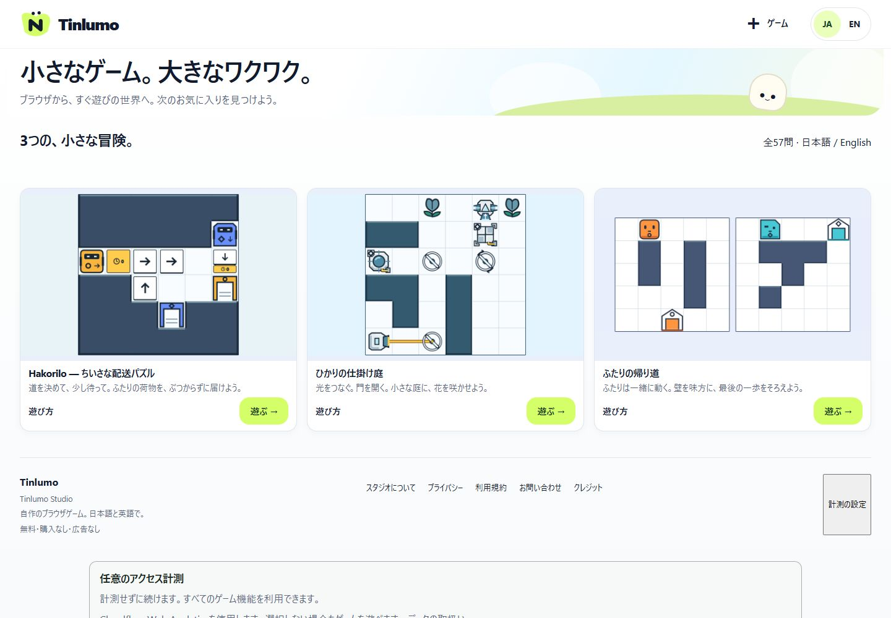
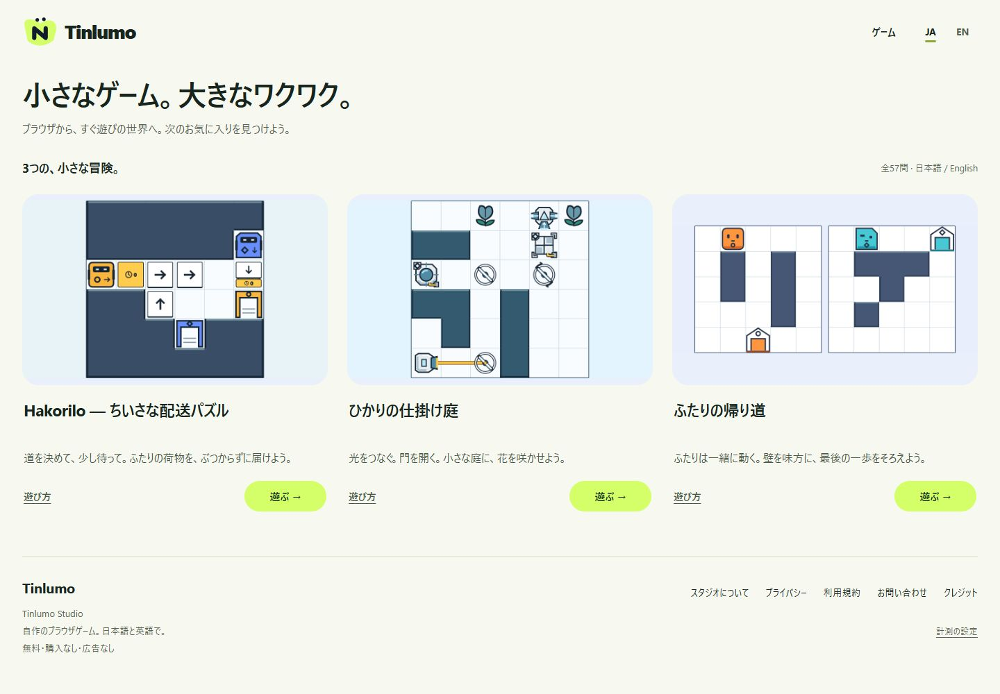
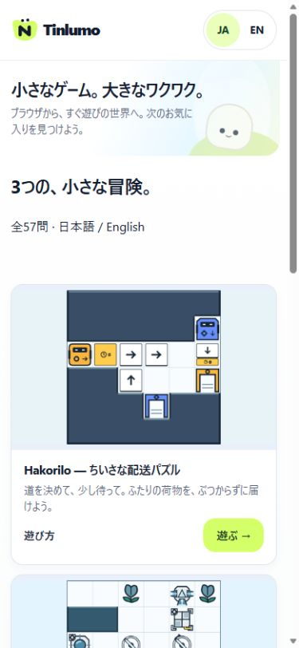
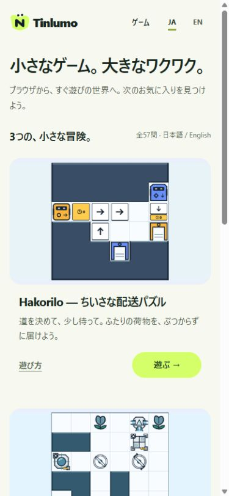
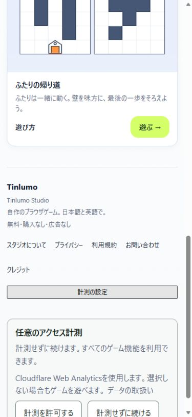
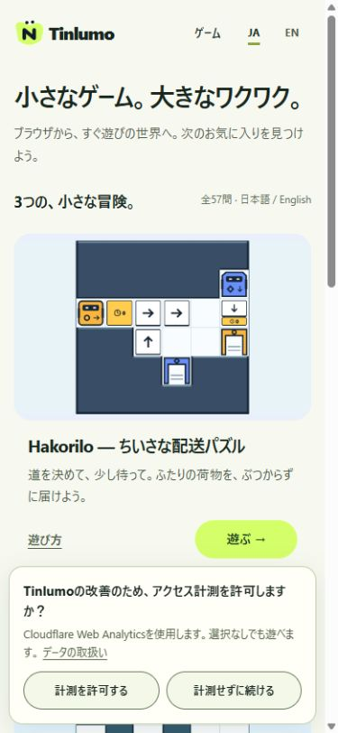

# Tinlumo MVP Visual Polish R1

2026-09-17 — **LOCAL_VISUAL_REVIEW_READY / HUMAN_VISUAL_ACCEPTANCE_PENDING**

主担当・独立read-only reviewerとも実利用モデル `gpt-6-astra`。本番未反映。stage / commit / push / deploy / Cloudflare変更0。公開中のauthorityは `cce29ca91f9dd9c5f81c120e94eb2fc872e145cb` のまま。

## Human review

ローカル候補：[日本語](http://127.0.0.1:4354/ja/) / [English](http://127.0.0.1:4354/en/) / [Games](http://127.0.0.1:4354/ja/games/) / [Privacy](http://127.0.0.1:4354/ja/privacy/)。loopbackのみ、noindex。これは新候補のレビュー環境であり、既存Productionの公開状態を変更しません。

| 対象 | Before | After |
| --- | --- | --- |
| Home / Games | 大きな装飾heroと枠・影付きカード | heroを軽量化、作品画像・タイトル・説明・遊ぶCTAの階層を明確化。カード外枠・影・hover浮上を除去 |
| Header | utility風のGamesアイコン・言語ピル | Tinlumoロゴを保持、Gamesと日英を簡潔なナビに整理 |
| Footer | 事務的なリンクと設定ボタン | ブランド、情報リンク、控えめな計測設定の順に整理 |
| 計測選択 | 選択後も残る大きなpanel | 未選択時と設定を開いた時だけ小型bottom banner。許可/拒否は同等。選択後・再訪時は非表示 |
| 運営ページ | 横に広い長文 | 最大68ch、見出し・段落・節間の余白を整理。日英本文10ページはCopy Cleanup版とbyte一致 |

背景は明るいoff-white、既存limeとdark textを継続。新規画像・機能・アニメーション・個別ゲームUI変更なし。検索やカテゴリは追加していません。

## Screenshots

画像はローカル候補のブラウザ表示です。スマホはviewport検証で、実機PASSではありません。BeforeはCopy Cleanup候補、Afterは今回の候補です。

| Desktop JA Before 1440×1000 | Desktop JA After 1440×1000 |
| --- | --- |
|  |  |

| Mobile JA Before 390×844 | Mobile JA After 390×844 |
| --- | --- |
|  |  |

| Consent Before | Consent After |
| --- | --- |
|  |  |

追加確認：[English desktop 1200×1000](screens/after-desktop-en.png)、[English mobile 390×844](screens/after-mobile-en.png)、[desktop consent settings](screens/after-consent-desktop-en.png)、[320px Footer/consent](screens/after-consent-footer-320-en.png)、[Games mobile](screens/after-mobile-games-ja.png)、[JA Contact](screens/after-mobile-contact-ja.png)、[JA Privacy](screens/after-mobile-privacy-ja.png)、[EN Privacy](screens/after-desktop-privacy-en.png)。

Edgeの自動翻訳が英語Portal表示に介入したため、英語の最終画像は自動翻訳のないin-app browserで取得。サイト文言やブラウザの恒久設定は変更していません。

## QA

- 対象公開profile build **PASS**：28生成ページ、52配布ファイル、採用payload18保持。出力 `.cache/tinlumo-visual-polish-r1`、[manifest](candidate-manifest.json)。既存public buildをrepo内一時helperで出力先分離して利用。fixture用の通常buildで上書きしない。
- 型検査 **0 errors / 0 warnings / 3既存hints**。
- `npm test` **214/215 PASS、1既知FAIL**。既存locale/consent/projection関連 **10/11 PASS、1既知FAIL**。下表参照。今回のためにテストの期待値やscannerを変更していません。
- [配布・ルートQA](technical-qa.json)：27Portalページ、3ゲームframe、全内部参照、canonical/hreflang/sitemap、support表示、12HTTPチェック、不要path404 **PASS**。内部資料・fixture・候補・秘密鍵を配布しない。
- [差分・保全QA](diff-qa.json)：Copy Cleanup本文10HTML一致、非style配布payload23一致、既存公開artifact52一致、採用RC48一致。既存2082ファイルを変更許可3path以外で保全、開始時untracked37ファイル（無関係13・以前のpostflight・copy証拠を含む）を保全。
- desktop JA1440×1000 / EN1200×1000、mobile390×844、最小幅320×740を確認。JA/ENで横はみ出しなし。Header・3作品CTA・Footer・本文を確認。
- 3作品の通常導線・日英起動 **PASS**。Hakorilo D01、Lightwork L01、Two Ways最初の面を操作・クリア。保存完了後の再読込でクリア履歴または盤面を復元し、言語切替でも保持。全57問を再採点したとは扱いません。
- 計測UI：未選択表示→拒否で消える→再読込も非表示、Footerから再表示/許可ボタンへfocus→許可で消える→再読込も非表示→再表示/拒否への変更 **PASS**。キーボードEnterから設定を開けることを確認。
- 独立reviewで固定bannerによるFooter遮蔽を発見し、表示中だけ余白を確保して自己修正。320×740でFooter設定bottom407.56px、banner top532.75px、横幅305/305px。未選択のままスクロールしてFooterを利用可能。
- [配布security](distribution-security.json)：**PASS、検出0**。全project raw scanは **FAIL、既知2件のみ、新規0**。`.tmp/physical-mobile-r2/tls/server.key` / private-key は既知TRUE SECRET LOCAL DEV ONLY。`.tmp/r3-before/manifest.json` / generic-api-key は既知SHA FALSE POSITIVE。raw結果をPASSへ変更せず、既存承認を新規候補へ拡張しない。hook/allowlist/scanner設定変更なし。

### Analyticsの証拠範囲

| 条件 | 今回の確認 |
| --- | --- |
| consent前 | local実ブラウザのprovider JS/resource0 |
| deny | local実ブラウザのprovider JS/resource0、再訪時banner非表示 |
| allow | UI保存・非表示・再訪を実ブラウザ確認。localhostは既存hostname guardでprovider通信0。正規production hostnameでmanual script1回のみの既存unit検証PASS |
| 設定変更 | Footerからallow/deny変更可能。既存revocation/保存失敗/Preview/iframe guardのunit PASS |
| automatic injection | ローカルHTMLのeager provider script0、設定ファイル不変。Cloudflare APIは今回照会・変更していない |

`src/rc/analytics-consent.js`と配布JSはbyte不変。既存Productionでconsent前0・reject0・allow後manual JS/RUM実通信・auto_install=falseを確認した[公開時証拠](../public-deploy-go-r1/REPORT.md)を再利用します。今回の候補をProductionに配信した、または今回のローカルallowでprovider通信を行ったとは主張しません。

### 旧前提による失敗

| テスト | 原因 / 扱い |
| --- | --- |
| `tests/unit/rc-readiness.test.ts:20` | publicContact=nullを期待するが、既存authorityはsupport@tinlumo.com。前工程でHEADでも同一失敗を再現。今回source/期待値不変 |
| `tests/release-prepare.mjs:18` | approved-dist不存在を期待するが、公開済みartifactが存在。prepareは安全にfalseを返し新出力なし。既存artifactを消してテストに合わせない |

新規回帰は確認範囲で0。実機、聴感、screen readerでの選択直後の読み上げ、旧ブラウザの`:has`対応はNOT TESTED。未対応ブラウザは旧status panelが残るfallbackとなり、機能的なconsentロジックは維持されます。外部初見DEFERRED / NOT TESTEDを変更しません。

## Touched files / reproducibility

今回のsource：`src/rc/Layout.astro`、`src/rc/AnalyticsConsent.astro`、新規 `src/rc/portal-polish.css`。記録：`docs/games/PRODUCTION_CURRENT.md`、本QAディレクトリ。既存Copy差分の `PublicOperations.astro` / `site.json` はそのまま保全。global stylesheet、ゲーム、save、consent JS、Cloudflare設定は変更なし。

loopback停止時のみrepoルートから `node .tmp/visual-polish-r1/server.mjs`（127.0.0.1:4354）。再build：`node .tmp/visual-polish-r1/build.mjs --verify-manual-snippet`。差分検査：`node .tmp/visual-polish-r1/existing-local-qa.mjs` と `node .tmp/visual-polish-r1/final-qa.mjs`。旧4352/4353や本番のプロセス・artifactは操作しません。

Git index空、HEAD/upstream維持。残Gateは **Human Visual Acceptance**。それまではcommit/push/production deployを実行しません。今回を最終polish passとし、明確な欠陥以外の追加調整は行いません。
