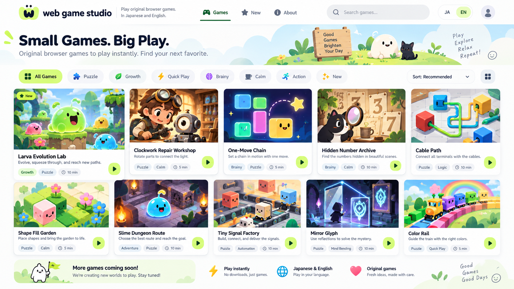
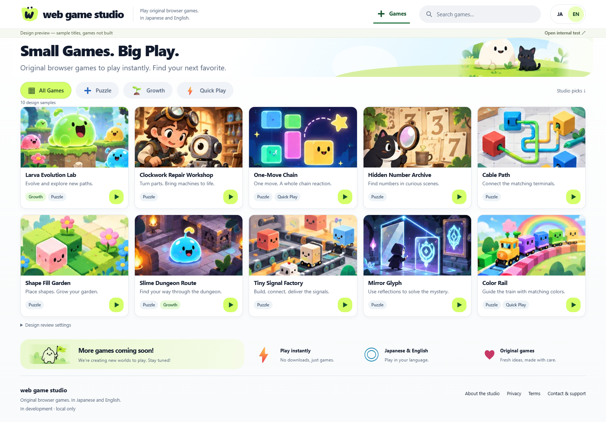

# Portal Visual R1 — Human review package

**現在の採用状態: Concept A実装方向・日英PC HomeはHuman PASS、日本語スマホHome提示画像はVisual PASS。Play受入・物理スマホ操作・公開可否は未承認。** 詳細は末尾の[Human Acceptance追記](#human-acceptance)を参照。

以下はローカル実装完了時の技術QA・作業状態を保存した記録。その後のHome採用とローカルcommit許可は末尾に追記し、技術QAや過去の未commit状態を事後的に書き換えない。

**PORTAL_VISUAL_R1_TECH_QA_PASS_HUMAN_REVIEW_PENDING**

2026-09-13 JST。Concept Aと5点の調整を実装。最終Human受入・実ゲーム制作・公開は未実施。

## 開くURL

| 内容 | 日本語 | English |
|---|---|---|
| 仮10作品のHome | [開く](http://127.0.0.1:4323/ja/design-preview/) | [Open](http://127.0.0.1:4323/en/design-preview/) |
| Play周辺の見本（ゲーム未制作） | [開く](http://127.0.0.1:4323/ja/design-preview/play/larva-evolution-lab/) | [Open](http://127.0.0.1:4323/en/design-preview/play/larva-evolution-lab/) |
| 見本の詳細 | [開く](http://127.0.0.1:4323/ja/design-preview/games/clockwork-repair-workshop/) | [Open](http://127.0.0.1:4323/en/design-preview/games/clockwork-repair-workshop/) |
| 実際に動く内部fixture | [開く](http://127.0.0.1:4323/ja/play/connection-lab/) | [Open](http://127.0.0.1:4323/en/play/connection-lab/) |
| 通常データ・公開0作品 | [開く](http://127.0.0.1:4322/ja/) | [Open](http://127.0.0.1:4322/en/) |

4323は明示的なDesign静的ビルドのローカルpreview、4322は通常静的ビルドの既存preview。4321は今回の案内URLではない。127.0.0.1限定で、公開・deployではない。異なるport間の保存は別originのため共有しない。同一portの日英では共有する。

## KEEP / CHANGE / 自己レビュー

| 基準 | 結果 |
|---|---|
| 白系・明るさ・可愛い挿絵・ライム | 白〜淡い背景、濃い文字、ライム操作、マスコット/下部挿絵を維持。仮WはSVG、カードの文字・検索・操作は実HTML |
| 5列のArtwork中心の棚 | 1672/1440pxで5列、1024で4列、768で3列、390で2列、320で1列。タイトルと行動説明を常時表示 |
| 調整1 Hero縮小 | 参照の約133pxに対しPC導入帯108px、約19%縮小。コピーと挿絵を維持。見本明示帯・件数表示は追加するため上端全体を同率に縮めてはいない |
| 調整2 人型削除 | アカウント風アイコン・ログイン導線なし。JA/ENは44×44px以上 |
| 調整3 カテゴリ整理 | All / Puzzle / Growth / Quick Playの4個。実日付のないNewは表示しない。絞り込みと検索を併用、件数・0件・解除・戻りを実装 |
| 調整4 時間削除 | 未測定の5/10min、時計、架空評価・ランキング・人数なし。Studio picksは編集順のラベルであり、個人最適化・人気順ではない |
| 調整5 異なる絵柄 | 下部設定で最後の3枚をピクセル・抽象・機構SVGへ変更可能。10/2/0件と標準へ戻す操作を検証 |
| Play・補助画面 | Home/Card/PlayFrameを共通化。実fixtureは既存ゲーム表示を保ち、周辺だけ明るい外観へ。詳細・About・Privacy・Terms・Contact・404にも共通トークンを適用 |

追加差異: 生成文字を含む看板/手書きコピーは切出さず、マスコット部分とCSSの雲/丘を使用。カード1はNewを避けた切出しで構図が少し異なる。文字の読めるサイズを優先し、カード高は内容に応じて伸びる。下部には見本設定・法務草案へのリンクを追加。画像どおりの不均等なカード幅・未実装ソート/グリッド切替は再現していない。装飾の端はフェード処理。実ゲーム内の旧色はゲーム自身の表現として保全。

自己レビューでカードの過剰な高さ、Heroの切出し境界、日本語見出しの不自然な改行を修正。見本と実装の比較基準は「Artwork主役の明るい棚」で、ピクセル完全一致ではない。Mobile/PlayのHuman採用は未確定。

| 採用原画像 | 最新Desktop EN実装 |
|---|---|
|  |  |

## 実装スクリーンショット

すべて最終ビルドを実ブラウザで撮影。生成画像を実装証拠として流用していない。

- [Desktop Home EN / 1672×941 viewport](screens/home-en-1672.png)
- [Desktop Home JA / 1440px](screens/home-ja-1440.png)
- [Mobile Home JA / 390px](screens/home-ja-390.png) / [EN](screens/home-en-390.png)
- [Desktop Play見本 / 1440px](screens/play-en-1440.png) / [Mobile Play見本 / 390px](screens/play-ja-390.png)
- [内部fixture PC](screens/fixture-en-1440.png) / [Mobile](screens/fixture-ja-390.png)
- [絵柄混在](screens/home-en-mixed.png) / [画像失敗](screens/artwork-failure.png)
- [通常データのHome / 公開0件](screens/home-normal-ja-1440.png)

## 最新QA

| 検査 | 結果 | 根拠・範囲 |
|---|---|---|
| 型 | PASS | `npm run check`: 34 files、error/warning/hint 0 |
| 単体 | PASS | `npm test`: 12/12。既存10件を維持、検索用adapter/関連重複排除・最大4件を追加 |
| 通常/Design build | PASS | `npm run build`: 18 pages。`npm run build:design`: 60 pages |
| 通常HTTP routes | PASS | `npm run test:routes`: 3/3。日英16画面、root、404、抽出links/assets |
| 出力分離 | PASS | `node node_modules/tsx/dist/cli.mjs --test tests/visual-output.test.ts`: 2/2。通常distに見本route・metadata・Artworkなし、明示buildには存在 |
| ブラウザ回帰 | PASS | `node tests/visual.browser.mjs`: Edge/Chromium 153.0.4234.32、詳細は `browser-results.json` |
| レスポンシブ | PASS | 日英22画面×320/390/768/1024/1440/1672px=132組。横溢れ・壊れた画像0、h1各1 |
| 拡大 | PASS（限定） | 1440pxの200%相当の720 CSS px reflow、390pxで200% root文字拡大。代表Home/Play/About。実ブラウザUIのズーム操作とは区別 |
| 探索 | PASS | 日英名・説明検索、カテゴリ併用、解除/0件、10/2/0件、絵柄混在、対応言語、戻り、通常リンク/別タブURL。外部return URLは採用しない |
| 保存・入力 | PASS | Pointer/Enter/Space、reload/日英復元、reset cancel/Escape/confirm、他game save保全、壊れた/未知schema原データ保全。旧schema・quota・silent lossは単体 |
| 保存拒否 | PASS（注入） | ブラウザ上でlocalStorage getterを拒否に置換し、失敗表示と操作継続。実ブラウザ設定画面による拒否とは区別 |
| load failure | PASS | 故意失敗→iframe除去/操作無効→retry。fixture JSのready応答を止め、8秒timeout→error→復旧も確認 |
| mock ads | PASS | pause、Escape/skip/完了、報酬一回性、no-ad、日英遷移後cooldown、iframeからのTab退出。Escape後の元ボタンfocus復帰を修正し検証 |
| mobile input | PASS（emulation） | touch tap、390→844回転相当resize、保存不変。物理端末ではない |
| JSなし/画像失敗 | PASS | JSなしで検索等を隠し全カードとリンクは利用可能。画像失敗時も作品名・説明・リンクを保持 |
| 可読性 | PASS（限定） | 主/補助文字・ライム等の代表tokenで4.5:1以上、reduced-motion、filter/JA-ENの44px領域。包括的accessibility認証ではない |
| console/network | PASS | 検査ページでpageerror 0、外部origin要求0。Homeからゲームiframe/buildを取得しない。local runtime外部transportなし |
| Security | PASS | `node scripts/security-scan.mjs all` / `staged`。Gitleaks 8.30.1、値非表示。既存hook/allowlist変更なし。scanは漏洩ゼロの保証ではない |
| Diff/Authority | PASS | `git diff --check`、新規textも空ファイルとのdiff check。原Authority SHA256は開始時と同一 |
| lint | NOT TESTED | 設定なし |
| 物理スマホ・Human受入・公開素材権利 | NOT TESTED | 今回の技術QAから推定しない |

途中のブラウザテストは、絶対URLへのbase二重付加とiframe postMessageの非同期待機不足を修正。期待値を弱めず、必要な状態を待つ形で最終回帰を再実行。独立read-onlyレビューの「通常Play/detail経由の条件保持」「言語切替44px」も修正・回帰済み。

## Repo / 境界

- CWD: `C:\projects\Web Game Studio`、branch: `main`。
- 開始/終了基準HEAD: `b1185398c706ec4416d5dbe2b9dfe638f9c3ebfe`。開始時clean、終了時は本件の未commit変更あり。staged差分なし、stashなし。
- 既存upstream: `origin/main`。remoteは既存 `https://github.com/T-ishikawa00/web-game-studio.git` のまま。fetch/push等のリモート通信なし。
- `START_HERE_CODEX_WEB_GAME_STUDIO.md`不変、SHA256 `FAAB664608C7F80FE6A5E5E543A9D632ED23939E7A5DD6461E24EF19B22A3F73`。
- 変更: AGENTSのTier方針、README、build/preview切替、共通Layout/Hero/Catalog/Card/PlayFrame/PlayShell/Related、CSS、検索script、仮データ、切出しscript、Asset台帳、回帰test、原本/QA/screens。全pathは `worktree.txt`。
- 保存schema/キー/移行、iframe検証、広告間隔/報酬契約は不変。runtime差分は広告dialogから元ボタンへのfocus復帰のみ。関連resolverは重複除外と上限4件。
- 依存追加/更新なし、lockfile不変。cache/temp/ブラウザprofile/証跡は本repo内。操作による他repo・global書込みなし（他プロセスによる全PC変更不在までは主張しない）。
- **commit / push / deploy / 実広告 / 購入 / 外部サービス接続 / 外部メッセージ = 0。** 公開ゲーム0、内部fixture1、デザイン見本10。実ゲーム制作なし。

## Humanレビュー

1. PCのHomeが採用画像の良さを保っているか。
2. スマホで作品を選びやすく、Play周辺も同じ方向性でよいか。
3. ブラウザで触って気になる表示・動作があるか。

公開素材/正式名/権利、公開規約・運営者情報、実広告、最初の実ゲーム選定/制作、物理端末確認、公開可否は後続の別ゲート。ここでHumanレビュー待ちに停止する。

## Human Acceptance追記 — 2026-09-13

根拠: このタスクでHumanが実装画面を確認し、Homeの見た目を正式採用すると明示した発言。AIの自己レビュー・自動QAから推定した受入ではない。

| 対象 | Human判定 | 承認範囲 |
|---|---|---|
| Concept Aの実装方向 | PASS | 現在の実装方向を正式採用 |
| 日本語／英語のPC Home | PASS | 提示した日英PC Home |
| 日本語スマホHome | Visual PASS | 提示画像 `screens/home-ja-390.png` の見た目のみ |
| Play画面 | 未受入 | 技術QA PASSをHuman受入へ拡大しない |
| 物理スマホの操作 | 未確認 | 提示画像・エミュレーションは実機操作確認ではない |
| 公開可否 | 未承認 | Release/公開・実広告・ゲーム制作の許可ではない |

### 維持するVisual Baseline

現在の配色・Hero・カード・グリッド・全体の雰囲気を今後のVisual Baselineとして維持する。追加のデザイン変更・別案制作は行わない。基準画像は `screens/home-en-1672.png`、`screens/home-ja-1440.png`、`screens/home-ja-390.png`。原Concept画像と5調整も引き続き参照するが、今回Humanが採用した実装の見た目を独断で再設計しない。

### 差分確認とローカルcommitの範囲

- 開始HEADは `b1185398c706ec4416d5dbe2b9dfe638f9c3ebfe`、branchは `main`。前工程の45対象ファイルを確認し、今回のVisual実装・付随するQA/原本/Asset記録・明示依頼済みモデル割当方針以外の変更はない。
- Play等の実装・回帰証跡も、前工程で依頼された一括Visual実装としてcommitに含める。保存することは、それらのHuman受入を意味しない。
- 今回新たに編集するのは本QA記録、READMEの採用状態、AGENTSのBaseline参照のみ。アプリコード・CSS・画像・テストは変更しない。前工程の技術QA（ブラウザ16項目PASS、132画面幅組合せを含む）は既存実行記録として保持し、文書追記だけのための全ブラウザQA再実行は行わない。
- commit対象は上記45ファイルの明示リスト。ignoredのcache/build/temp、Security設定、Secrets、原Authority、依存lockfileは追加・変更しない。`worktree.txt` は前工程終了時のsnapshotでありcommit後の状態を示すものではない。
- Humanが追加許可した操作は、このVisual実装と採用記録のローカルcommitまで。既存Securityルールに従い全project/full-indexスキャンとDiff確認を行い、hookを維持してcommitする。実際のcommit SHA・最終worktreeはcommit後の完了報告で示す。
- push・deploy・実広告・購入・外部サービス接続・ゲーム制作は実施しない。公開ゲーム0本、内部fixture1本、仮デザイン見本10件の区別を維持する。
